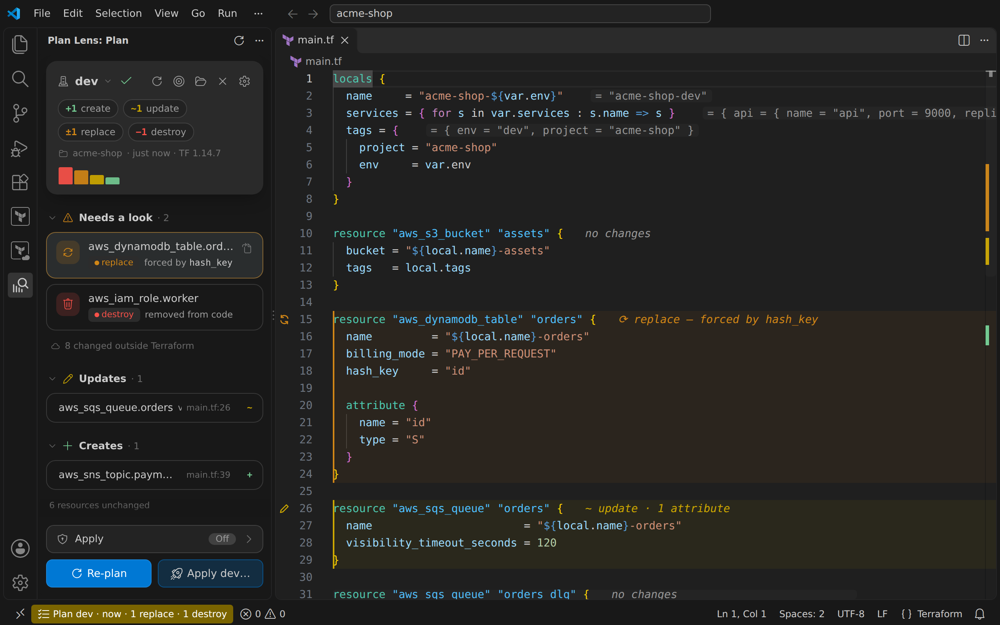
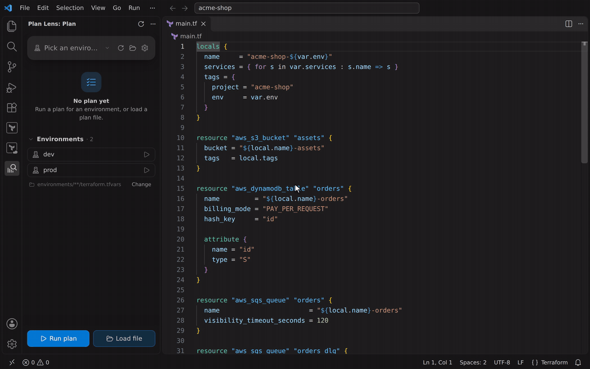
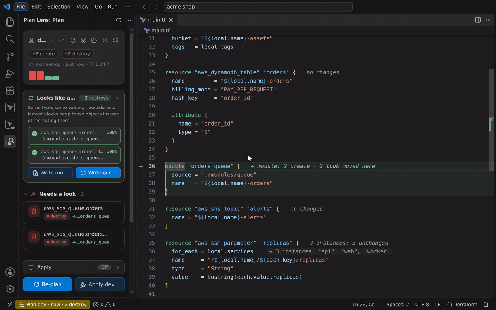
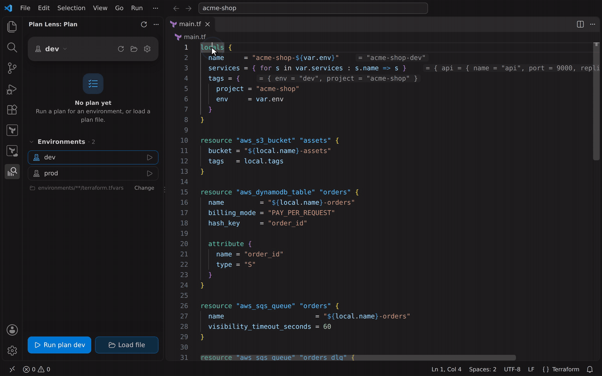
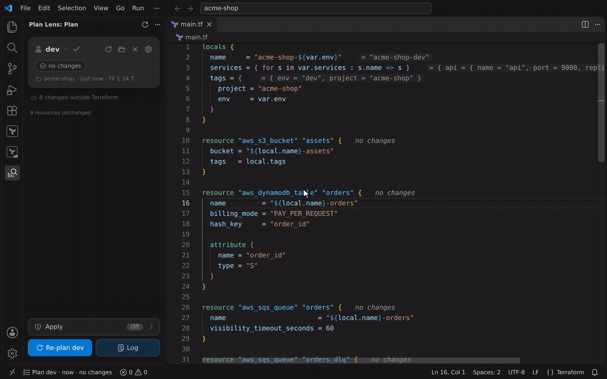

<p align="center">
  
</p>

<h1 align="center">Terraform Plan Lens</h1>

<p align="center">
  <b>Your Terraform plan, on your code.</b><br>
  See what every block will create, update, replace or destroy — refactor without recreating anything,<br>
  see your values as you write, and know what an edit does <i>before</i> you plan.
</p>

<p align="center">
  <a href="https://marketplace.visualstudio.com/items?itemName=jay-boo.tf-plan-lens"></a>
  <a href="https://github.com/Jay-boo/tf-plan-lens/actions/workflows/ci.yml"></a>
  
  
</p>

<p align="center">
  
</p>

`terraform plan` prints a wall of text in a terminal, far from the code it is about. You scroll, you search for `-/+`, you hope you didn't miss the line that replaces the production database. **Plan Lens puts the plan where you work:** on each block of your code, in a sidebar that shows the risky changes first, and in the hover with every attribute that changes and what forces the replace.

Works with **Terraform and OpenTofu**, any cloud (AWS, Azure, Google Cloud…), any layout: one folder, environments with their tfvars, Terraform workspaces, monorepos.

---

## Your plan, on your code

Click ▷ next to an environment. Plan Lens runs the plan and every `resource`, `data` and `module` block gets a gutter icon, a coloured band and a hint: `replace — forced by hash_key`, `update · 2 attributes`, `3 instances: 1 update · 2 unchanged`. The sidebar puts what needs a look first — replaces and destroys, including resources you removed from the code.

<p align="center"></p>

- **Hover** a block: before → after for every attribute, `forces replacement`, `(sensitive)`, `(known after apply)`.
- **The plan card**: `+1 create ~1 update ±1 replace −1 destroy`, and a bar per change, the riskier the taller — the blast radius at a glance.
- **Everything else in the plan**: imports (an import that is replaced right away is flagged), moved objects, output changes, and what changed outside Terraform — discreet by default.

## Refactor without recreating anything

Renamed a resource, moved it into a module, switched `count` to `for_each`? Terraform plans a destroy and a create: the object would be **recreated**. Plan Lens recognises the pairs — same type, same values, new address — and offers the `moved` blocks. **Write & re-plan**, and the destroys are gone.

<p align="center"></p>

Whole module moves fold into one `moved { from = module.old  to = module.new }`. Pairs it is not sure about are shown but never ticked for you. Nothing touches the state: the blocks go in `moved.tf`, reviewable in your PR.

## Your values, as you write

What does `{ for s in var.services : s.name => s }` actually give for prod? Plan Lens shows what locals, variables, `for_each` and outputs **evaluate to for the selected environment**, at the end of the line — and completes map keys and object fields from your real data.

<p align="center"></p>

It is Terraform's own evaluator (`terraform console`) with the environment's variables, run on Plan Lens's own copy of your configuration with an **empty local state**: your team's state is never read or locked. Select any expression and run **Evaluate selection** to see its value.

## Know before you plan

Once an environment is planned, **saving a file previews just the blocks you edited**: a read-only, targeted plan says on the edited lines what that would do — before anyone runs the full plan.

<p align="center"></p>

`-target` on the edited blocks, `-refresh=false`, `-lock=false`: seconds, not minutes, never blocks a teammate, never applied.

---

## And also

- **Environments with no setup** — `environments/*/terraform.tfvars` (+ `backend.conf`), any folder of tfvars, every Terraform root of a monorepo, Terraform workspaces (local, or listed from the backend).
- **Targeting** — pick changes or whole modules, plan with `-target`, see what Terraform pulled in as dependencies.
- **Apply the exact plan you reviewed** — opt-in per workspace; a destroy or replace asks you to type the environment's name. Terraform refuses it if the state moved since.
- **Stuck state lock** — shows who holds it and since when, force-unlocks after you confirm.
- **Expired cloud login** — offers `az login`, `aws sso login` or `gcloud auth application-default login` in a terminal.
- **Load a plan file** from your CI (`terraform show -json`, or a binary plan).
- **A settings page** in the sidebar: what each section shows (*shown*, *discreet*, *hidden*), every feature on or off.

## Safe by design

| | Touches your real state? |
|:--|:--|
| Plan, targeted plan | Reads it, like `terraform plan` (own `TF_DATA_DIR`: your `.terraform` is never touched) |
| Preview on save | Reads it, **without the lock** (`-lock=false`, `-refresh=false`) |
| Values, completions | **Never**: an isolated copy with an empty local state |
| Refactor | **Never**: writes `moved` blocks to `moved.tf` |
| Apply | Only when you turn it on, after a confirmation, on the exact saved plan |

Plan Lens runs Terraform only in [trusted workspaces](https://code.visualstudio.com/docs/editor/workspace-trust). It sends nothing anywhere: no telemetry, no account.

## Get started

1. Install **Terraform Plan Lens**, open a folder with Terraform code.
2. Open the Plan Lens view in the activity bar.
3. Click ▷ next to an environment (or **Run plan**). Your usual credentials are used (`az login`, AWS profile, `gcloud`…).

No environment layout to adopt: a plain folder with `.tf` files works. Plan Lens pairs well with HashiCorp's Terraform extension (syntax, completion of the language): they don't overlap.

## Settings

All in the sidebar's settings page (gear), or as `planLens.*` settings.

| Setting | Default | |
|:--|:--|:--|
| `planLens.editorMarkers` | `true` | The plan on the code: gutter icon, band, hint |
| `planLens.inlineValues` | `true` | Values as you write |
| `planLens.completions` | `true` | Completions from the evaluated values |
| `planLens.preview` | `true` | Preview edited blocks on save |
| `planLens.refactor` | `true` | Refactor autopilot |
| `planLens.showUnchanged` | `true` | Faint "no changes" hint on untouched blocks |
| `planLens.sidebar.drift` / `.reads` | `discreet` | `shown`, `discreet` or `hidden` |
| `planLens.sidebar.imports` / `.moved` / `.outputs` | `shown` | `shown`, `discreet` or `hidden` |
| `planLens.allowApply` | `false` | Apply from Plan Lens (per workspace) |
| `planLens.terraformPath` | (empty) | `terraform`, else `tofu` when only OpenTofu is installed |
| `planLens.environmentsFolder` | (empty) | Folder holding the environments |
| `planLens.environmentGlob` | `environments/**/terraform.tfvars` | Where environments are found |
| `planLens.root` | (empty) | Terraform root, when it can't be guessed |

Colours are theme colours (`planLens.create`, `planLens.replace`, …): override them in `workbench.colorCustomizations`.

## FAQ

**Does it need my cloud credentials?** For plans and previews, the same as `terraform plan` does. Values and completions don't: they never read the state.

**Terraform Cloud / HCP Terraform?** Load the plan JSON of a run (**Load plan file…**). Running plans from Plan Lens needs a backend Terraform can plan against locally.

**Where do the GIFs come from?** A real VS Code on an ordinary AWS project, applied on [LocalStack](https://localstack.cloud) — every plan you see is Terraform's own. `npm run demo` records them again.

## Development

```
npm install
npm run test:unit   # model tests
npm run render      # sidebar screenshots in out-render/, fails on overflow
npm run e2e         # VS Code end to end on a real refactored root (needs terraform)
npm run demo        # README GIFs (needs docker and terraform)
npm run package     # tf-plan-lens-<version>.vsix
```

MIT licensed.
